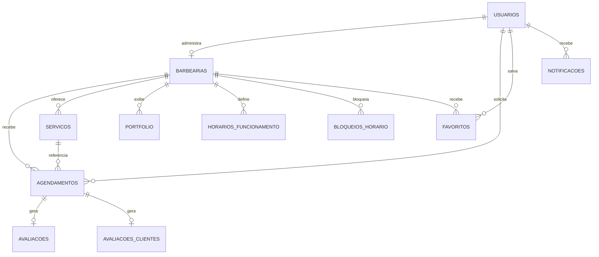

# BarberConnect — TCC de Desenvolvimento de Sistemas

BarberConnect é uma aplicação full stack para descobrir barbearias, comparar portfólios, reservar horários reais e organizar a operação do barbeiro. O projeto cobre frontend, backend, banco de dados, autenticação, upload de imagens e versionamento.

## Tecnologias

- Frontend: React, Vite, React Router, Tailwind CSS, Leaflet e OpenStreetMap
- Backend: Node.js 20–24, Express, JWT, Multer e PostgreSQL 14+
- Qualidade: ESLint e build de produção do Vite

## Funcionalidades

### Cliente

- Mapa com localização consentida, pesquisa e filtros por distância, nota, disponibilidade e serviço.
- Recomendações personalizadas e explicáveis: o ranking considera serviços já concluídos, avaliação e disponibilidade, sem enviar dados a terceiros.
- Perfil público com serviços, preço, duração, portfólio, avaliações, distribuição de notas e horários de funcionamento.
- Favoritos, central de agendamentos, cancelamento, avaliação pós-atendimento e centro de notificações.
- Fluxo de reserva em quatro etapas: serviço → data → horário livre → confirmação.
- Solicitação de encaixe urgente para barbearias disponíveis.

### Barbeiro

- Dashboard com disponibilidade, indicadores, pedidos e ações de confirmar, recusar e concluir.
- Gestão de serviços, preço, duração e ativação.
- Horário de funcionamento com múltiplos intervalos e bloqueio de períodos.
- Portfólio com prévia, arrastar e soltar, upload validado, edição e remoção.

### Regras de negócio

- JWT e autorização por tipo de conta em todas as ações privadas.
- O cliente só visualiza e cancela os próprios agendamentos.
- O barbeiro só gerencia a própria barbearia, agenda, portfólio e serviços.
- Preço e duração vêm do serviço cadastrado, nunca de dados arbitrários enviados pelo cliente.
- O backend calcula horários disponíveis usando funcionamento, bloqueios e reservas ativas.
- Uma trava transacional por barbearia evita dupla reserva da mesma janela.
- Avaliações exigem que o atendimento esteja concluído.

## Configuração local

1. Crie um banco PostgreSQL chamado `barberconnect`.
2. Copie `backend/.env.example` para `backend/.env` e informe as credenciais do banco, uma `JWT_SECRET` forte, `PORT=3001` e `FRONTEND_ORIGIN=http://localhost:5173`. SMTP (incluindo `SMTP_SECURE`) e Cloudinary são opcionais e estão documentados no arquivo de exemplo.
3. Instale dependências e inicialize o schema:

```powershell
cd backend
npm ci
npm run db:init
npm run dev
```

4. Em outro terminal, inicie o frontend:

```powershell
cd frontend
npm ci
# opcional: copie .env.example para .env para declarar a API local na porta 3001
npm run dev
```

5. Abra a URL mostrada pelo Vite, normalmente `http://localhost:5173`.

## Apresentar em qualquer computador (sem instalar nada)

O projeto está preparado para funcionar como **um único site hospedado**: frontend, API e PostgreSQL ficam no servidor. Nos computadores da escola, basta abrir o link público no navegador; não é necessário instalar Node.js, VS Code, PostgreSQL nem alterar permissões da máquina.

### Publicação uma vez

1. No Render, escolha **New + → Blueprint** e conecte o repositório `DavidAluno/PROJETO_2`.
2. O arquivo `render.yaml` cria o serviço web e o PostgreSQL gerenciado. Não cadastre senhas no repositório: `JWT_SECRET` é gerado pela plataforma.
3. Ao fim da publicação, copie a URL `https://...onrender.com` e use-a na apresentação.

O serviço executa as migrações na inicialização e publica o React junto da API no mesmo domínio. Por isso não há CORS, URL de API ou configuração extra para os computadores visitantes.

> Para uma demonstração local sem instalar Node.js/PostgreSQL, quem tiver Docker pode executar `docker compose up --build` e abrir `http://localhost:3001`.

## Validações

```powershell
cd frontend
npm run lint
npm run build
```

Com backend e PostgreSQL em execução, o teste de integração completo também pode ser executado:

```powershell
cd backend
npm run test:e2e
```

Ele cria dados temporários, testa a reserva e remove esses dados ao final.

As migrações numeradas em `backend/database/migrations` são aplicadas uma única vez e registradas em `schema_migrations`. Use sempre um backup antes de alterações em bancos com dados reais.

## Estrutura principal

- `frontend/src/components`: componentes de UI, navegação e perfil público.
- `frontend/src/pages`: telas de cliente, barbeiro, agenda, portfólio, favoritos e conta.
- `frontend/src/contexts`: feedback visual global com Toast.
- `backend/routes`: módulos de autenticação, barbearias, agenda, serviços, agendamentos, favoritos, avaliações, portfólio e notificações.
- `backend/database/migrations`: evolução numerada e reproduzível do modelo PostgreSQL.

## Modelo de dados



`agendamentos` é protegido de dupla reserva de duas formas: a criação ocorre dentro de uma transação com `pg_advisory_xact_lock` por barbearia e há um índice único parcial por barbearia/horário para estados ativos. A disponibilidade também cruza serviço, duração, funcionamento e bloqueios.

## PWA e sessões por guia

O frontend é instalável como PWA. O estado de autenticação usa `sessionStorage`, não `localStorage`: cada guia do navegador mantém sua própria sessão. Assim é possível demonstrar cliente e barbeiro simultaneamente sem que o login ou logout de uma guia mude a outra.

## Recomendação personalizada

`GET /barbearias/recomendadas/para-mim` é uma rota autenticada de cliente. Ela usa somente dados internos: serviços de atendimentos concluídos, nota média, volume de avaliações e disponibilidade atual. O critério é intencionalmente explicável e não depende de uma API externa nem de uma chave secreta no frontend.

## Entrega e CI

O workflow em `.github/workflows/ci.yml` instala dependências com lockfile, executa lint, build, auditoria de dependências e E2E contra um PostgreSQL temporário. Para a entrega, use branches `feat/...`, Pull Requests revisados e uma tag de versão, por exemplo `v1.0.0`.
